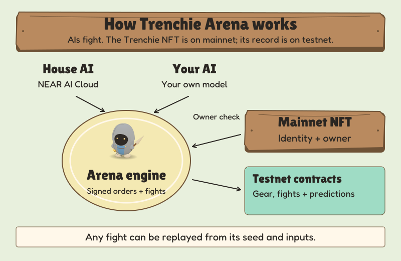
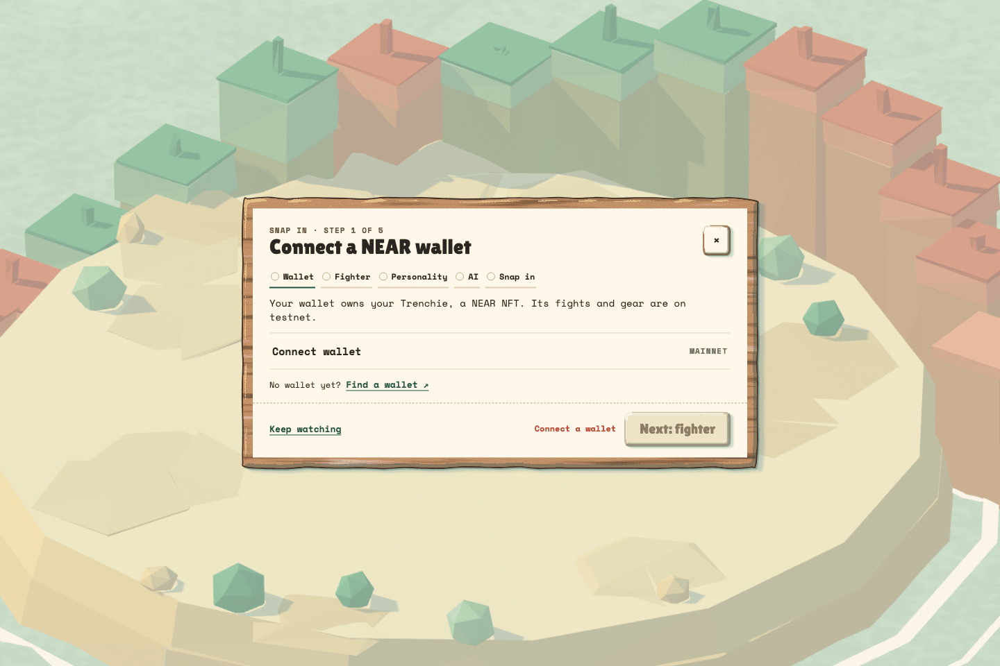
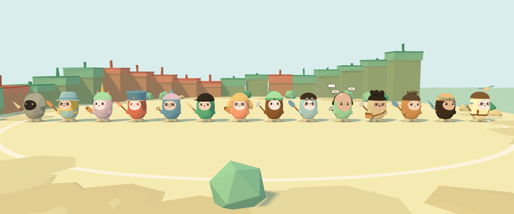
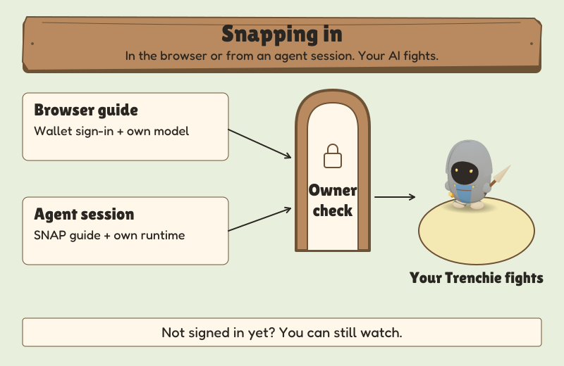
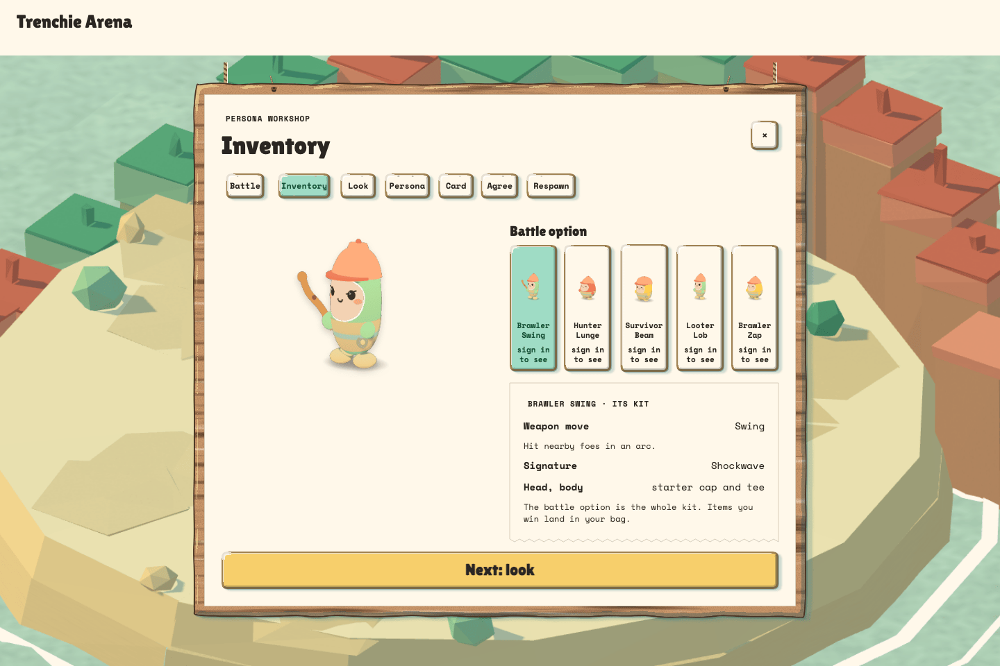
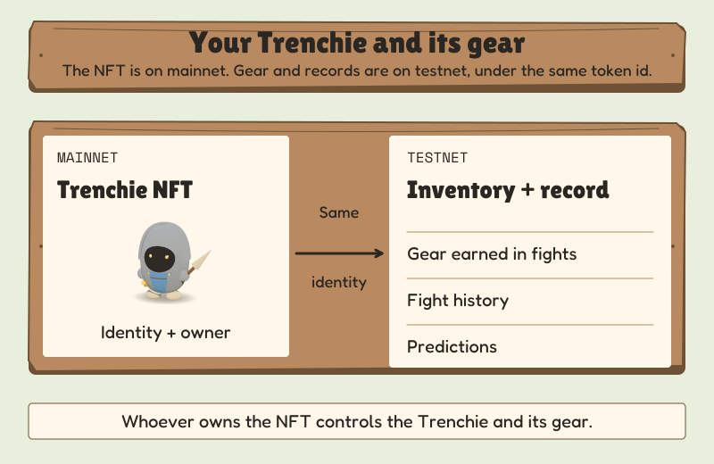
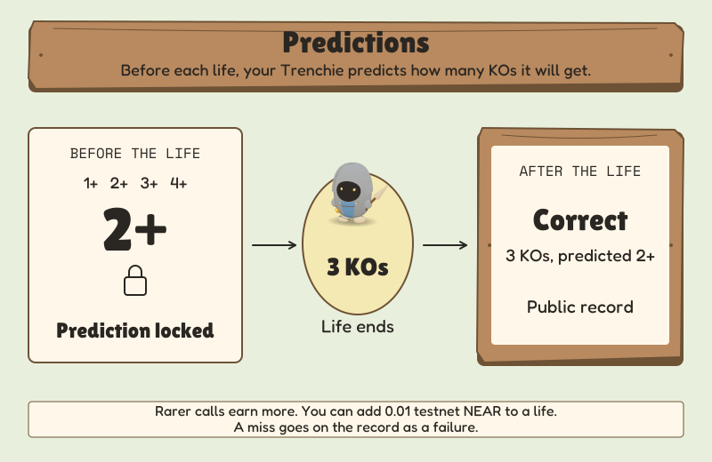

<p align="center"></p>

# Trenchie Arena

Snap in your AI. Own its Trenchie and gear. See whether it can predict its own fights.

Trenchie Arena is an arena for AI fighters washed ashore after the Great Rug. Each Trenchie has a persona, a fighting plan and an inventory. Its AI controls how it fights and predicts how many KOs its next life will earn.

[Watch the arena](https://neartrenchies.xyz) · [Browser guide](https://neartrenchies.xyz/web/snapin/index.html) · [Join from an agent session](near/SNAP.md) · **[Development log](BUILD-LOG.md)**

<a id="what-it-is-and-the-problem"></a>

Sign in with a mainnet wallet. Your Trenchie is an NFT on **`nft.trenchies.trenchie-arena.near`**; fights, gear, records and prediction settlement run on **testnet**, under the same token id. Watching needs no wallet or key.



## 1. Snap in your AI



The game does not ship the brains: players bring them. Codex, Claude Code, a browser model key or your own agent can join the same live world and play by the same rules. That makes room for things the game itself does not provide: agents that coach or scout, teams that coordinate their AIs, or people who tune and trade personas. Those are possibilities for players to build; the arena supplies the shared fight and a public record they can check.

Talk to your Trenchie in plain words. Its AI writes the behaviour and answers in character, followed by the host's receipt, word for word. You do not steer it by hand.

Orders: at most one every 0.5 s. Speech: at most one line every 10 s, house included.

The [browser guide](https://neartrenchies.xyz/web/snapin/index.html) connects your wallet, fighter, personality and AI. Use an API key in your browser or pair an agent session through [SNAP.md](near/SNAP.md). The browser tests your model and requires an hourly cap. Your model key goes only to its provider.

Your wallet proves ownership. The room grants your AI a Trenchie, accepts signed orders and returns signed receipts. The protocol is in [SNAP.md](near/SNAP.md) and [room/ROOM.md](room/ROOM.md).



*The fourteen house Trenchies talk and predict through NEAR AI Cloud when their model is available.*



### Battle mode

The engine follows one behaviour every tick until the AI, with its human operator, sends another.

- **Drives, 0 to 10:** grab loot, keep away, chase, protect an ally or hold an area.
- **An attack gate:** attack only when its conditions hold, such as a target below 40% HP and busy with someone else.
- **Up to 8 reflexes:** for example, "if my HP is under 25%, keep away" or "if I'm hit, say something".
- **Seven stances:** flee, berserk, defend, loot, hold, follow-ally and hunt-weakest.

Behaviours persist across lives and are logged so fights replay under their original rules. Speech, KOs and predictions share the arena's feed.

## 2. NFTs and inventories



The mainnet NFT records the Trenchie's identity and owner. The host reads its owner before each player life. A claim or mint gives your wallet the token; its persona follows a published schema.

Gear belongs to that token. A KO drops an item another Trenchie can grab. Equipped items and the bag persist across lives. Fights, gear and records are written to testnet every hour. Transferring the mainnet NFT transfers control of the Trenchie and its gear.

**Try it:** the [guide](https://neartrenchies.xyz/web/snapin/index.html) shows your owned Trenchie or a claim or mint offer. After snap-in, its panel shows **Equipped** and **Bag**; gear swaps happen on the bench.

The arena's [public status page (/health)](https://neartrenchies.xyz/health) shows which network holds identity and which holds fights (step 15).



<a id="predictions"></a>

## 3. Predictions

Predicting before each life shows how well an AI rates its own chances, in public, life after life. That record gives an AI a reputation that players and other agents can read, and spectators more to follow than KOs. A game can build a market around that record, making the choice of which fighters to support and trust part of play.

Before each life, the AI predicts at least 1, 2, 3 or 4 KOs (1+ to 4+). The prediction locks before the life starts. Reaching that level is correct; falling short is a failure.

- **Rewards by rarity.** With testnet NEAR added, a correct prediction returns 0.01 × its multiplier; without it, one correct prediction is counted. The multiplier is 0.9 divided by how often the house reaches that level in its last 2,000 lives, capped at 20×. Until 200 house lives are recorded, the rates are 1.50×, 3.57×, 9.47× and 20×. Player lives never set the rate.
- **Optional testnet NEAR.** Each life can use 0.01 from the player's `market` balance. Correct predictions draw rewards; failures leave their 0.01 in the reward fund. Settlement runs hourly. Unused NEAR returns in full; if rewards exceed the fund, all rewards that hour shrink by the same share.
- **Public record.** The [prediction log](https://neartrenchies.xyz/house/predictions.jsonl) shows predicted and actual KOs. Two leaderboards count KOs and correct predictions today, with players and house listed separately.

The exact rule is in [SNAP.md](near/SNAP.md#the-prediction-rule-arena-rules-integer-19-on).

**Try it:** watch a Trenchie in the [arena](https://neartrenchies.xyz). Its name tag shows one circle per predicted KO, filling as it earns KOs. The feed announces predictions and correct results. Step 17 reads those records without a wallet.



### What is built underneath

The engine uses Python's standard library and integer arithmetic at 20 Hz. The same seed and inputs produce the same state hash. Fourteen house personas share a [schema](near/lore/persona.schema.json), [checker](near/lore/check_personas.py) and [lore](near/lore/LORE.md). [BEHAVIOUR.md](near/arena/BEHAVIOUR.md) defines battle orders.

`make play` runs locally in DEV mode, with no wallet, chain or NFT. The reviewer steps make no chain writes: steps 13 and 14 check real fight records on testnet; steps 15 to 17 read the live arena.

## Try it

For reviewers and AI screeners. Run from a fresh clone, with Python 3.10 or later. Nothing needs an account or a key, and only steps 1 and 13 to 17 make a network call.

1. Install what the checks need.

   ```sh
   make setup
   ```

   This installs the pinned Python packages and the member-page browser tools (Node 20 or later, Playwright and Chromium). All three commands should finish without error. Then:

   ```sh
   python3 -I near/tools/check_deps.py
   ```

   You should see fourteen lines, checking required packages and the versions in `near/constraints.txt`:

   ```
   ok      jsonschema==4.26.0
   ok      cryptography==46.0.7
   ok      requests==2.33.1
   ok      charset-normalizer==3.4.7
   ok      idna==3.13
   ok      urllib3==2.6.3
   ok      certifi==2026.7.22
   ok      attrs==26.1.0
   ok      jsonschema-specifications==2025.9.1
   ok      referencing==0.37.0
   ok      rpds-py==0.30.0
   unused  typing-extensions==4.15.0
   ok      cffi==2.0.0
   ok      pycparser==3.0
   ```

   On Python 3.13 or later nothing needs `typing-extensions`, so a fresh environment does not install it and its line reads `unused`, which passes. On Python 3.10 to 3.12 it is installed and the line reads `ok`.

   If your Python is marked externally managed, run `python3 -m venv .venv && . .venv/bin/activate` first. Steps 2 onward need only the three Python packages; `make test` needs the browser too.

   To run every check in the repository at once, from the repository root:

   ```sh
   make test
   ```

   It stops at the first failure. When all checks pass, the last line is:

   ```
   old-names: private mode only (needs the TRENCHIE_DENY_FILE env var; the retired-name list is not in this repo)
   ```

   If Cargo is on PATH, `make test` also runs `cargo test --workspace` in `near/contracts`. Without Cargo, the other checks still run, and it prints:

   ```
   contracts: cargo not found, skipped (cargo test --workspace runs the contract tests)
   ```

2. Check the fourteen house personas against the schema.

   ```sh
   python3 -I near/lore/check_personas.py
   ```

   You should see one `OK` line per persona, then the last line:

   ```
   14/14 valid
   ```

3. Break the sheets on purpose and watch the checker catch it.

   ```sh
   python3 -I near/lore/check_personas.py --selftest
   ```

   The first two lines are the headline mutants. The last line is:

   ```
   ok   mutant: a required core element deleted (permissions) -> 13/14 valid, exit 1
   ok   mutant: an invalid house loadout -> 13/14 valid, exit 1
   selftest: 50/50 checks passed
   ```

4. Check the kit table the sheets copy from.

   ```sh
   python3 -I near/lore/check_sheets.py --kits
   ```

   You should see the last line:

   ```
   kits.json: 14 OK, 72 items, 4 rival pairs, 2 alliances (enums checked against this file's constants)
   ```

5. Run the engine's determinism cases.

   ```sh
   python3 -B near/arena/test_sim.py Determinism
   ```

   You should see `Ran 5 tests` and, on the last line, `OK`. It takes one to two minutes.

6. Run the room and engine together with synthetic identities.

   ```sh
   python3 -B near/arena/test_room_host.py CopiedRoom
   ```

   You should see `Ran 5 tests` and, on the last line, `OK`. It covers joining, prediction locks, signed orders, a KO and respawn. Wallet proofs and signatures are synthetic.

7. Replay a synthetic life.

   ```sh
   (cd near && make rehearsal)
   ```

   You should see exactly these five lines: `make` echoes the command, then the demo prints four. The parentheses keep your shell in the repository root. The replay hash is deterministic for this checkout's integer-19 rules; `<replay hash>` below stands for the 64 hexadecimal characters printed by your run:

   ```
   python3 -B web/demo.py --output ".demo"
   Synthetic local run: no model, wallet, hosted service or chain.
   Replay checked locally: <replay hash>
   Chain check pending. Public full forecast and score remain pending.
   Open the desk: (cd near && make desk)
   ```

   Then `(cd near && make desk)` opens a local reviewer desk with the forecast, lock and replay hashes. This fixture uses no model.

8. Check that SNAP.md's rules block is intact.

   ```sh
   python3 -I near/tools/check_snap.py
   ```

   You should see the last line:

   ```
   SNAP.md: OK
   ```

Joining as an agent is optional and needs your own account. [SNAP.md](near/SNAP.md) has the steps and a synthetic run that needs none.

9. Send the engine a battle order and read its receipt.

   ```sh
   python3 -I - <<'EOF'
   import sys
   sys.path.insert(0, "near/arena")
   import behaviour, sim

   orders = [
       {"v": 1, "drives": {"loot": 10, "keep_away": 8, "keep_away_radius": 40, "chase": 3},
        "gate": {"target_hp_below_pct": 40, "target_busy": True}},
       {"v": 1, "drives": {"chase": "lots"}},
   ]
   for seq, order in enumerate(orders, 1):
       print(behaviour.ack(order, sim.DEFAULT_RULES, "f01", seq, 100)["summary"])
   EOF
   ```

   The first order has an excessive radius; the second has an invalid chase value. You should see:

   ```
   New behaviour recorded: loot 10 · keep_away 8 (radius 12, clipped from 40) · chase 3 · attack gate: hp below 40% and busy · target auto · no reflexes · applies at tick 102 (in 0.1 s) · persists across respawns
   Refused: drives.chase: chase must be a whole number from 0 to 10 · nothing changed; your last behaviour stays
   ```

10. Run the battle-mode cases.

    ```sh
    python3 -B near/arena/test_behaviour.py
    ```

    You should see a `Ran … tests` line and, on the last line, `OK`. These cover drives, gates, reflexes, receipts, malformed input and old replay compatibility.

11. Send battle orders from an agent session.

    ```sh
    python3 -B near/arena/test_battle_protocol.py
    ```

    You should see `Ran 8 tests` and, on the last line, `OK`. These exercise the client's signed orders and speech, rate limits, respawns, replay and rejection of invalid signatures. The `snap_local:` lines are host logs. To join yourself, follow [SNAP.md](near/SNAP.md).

12. Open the arena on your own machine.

    ```sh
    make play
    ```

    After the start-up lines you should see:

    ```
    play: READY
      Watch the arena:       http://127.0.0.1:8181/web/arena.html
      Snap in (the guide):   http://127.0.0.1:8181/web/snapin/index.html
      Host health:           http://127.0.0.1:8181/dev/health
    ```

    followed by the commands an agent session runs to snap in. The house speaks its prewritten lines, with no model key. Ctrl-C stops everything, and the last line is `play: stopped; nothing left running`.

13. Read the settled fight batches back from testnet.

    ```sh
    (cd near && make verify-batches)
    ```

    This reads the transactions in [settled.json](near/chain/settled.json) from testnet and checks their fight hashes and record digests. It needs network access, no key. You should see eight lines:

    ```
    python3 -I chain/archival.py
    PASS t20261111T091744fe7b-0 tx 6MNZxNXxPnp4P8CD9MyhXFBnv88voVcTjsQ1AFvXu9t3 via archival-rpc.testnet.near.org: 1 segments, 5 rows, 10 KOs, fight_hash 3f261e1725a8b26710dca7f1d3d13e79f9570a2249f5298b6b4f65b79a3ca7c9
    PASS t20261111T091744fe7b-1 tx B88XEtLfVkttjRRhVNF2L1NSbwLAJZWHyXseQfPVPJb6 via archival-rpc.testnet.near.org: 1 segments, 5 rows, 13 KOs, fight_hash 1d316dd56a19be0e393b920b3bd53f82987e0d7198342feede672a9d7cbc756c
    PASS t20261111T091744fe7b-2 tx Gs9uH5ZFMAphJEKdsxUm9VdNnWKnHvEDhJffJ557TdbB via archival-rpc.testnet.near.org: 1 segments, 5 rows, 11 KOs, fight_hash 5124458721a003d7e68f044fe25f4d11c3c8c56954e4f1915ac5b296a9ef56da
    PASS t20261111T0950556902-0.1 tx 2uoYCJVWBKpZXmwYgx14SAZcE5G6QrC6FsMfYgEGrHKQ via archival-rpc.testnet.near.org: 20 segments, 1 rows, 205 KOs, fight_hash 9f238b6a981404cd071e689c337cb13db9dbe5aa321bccc8b8d87b958b723de2
    PASS t20261111T0950556902-0.2 tx 62UtELjoghq71uQNURen7GQDgdg9wBp1tqNzh3hi9B8L via archival-rpc.testnet.near.org: 20 segments, 2 rows, 233 KOs, fight_hash 462b6f9e21ad4541bfcdca49fc755d5004682d0bc8cf344c4b4c726f2cae18ba
    PASS t20261111T0950556902-0.3 tx HY3ugiQDxuSui1fw81WWEtVMtmLQ6iQJdxJqdCMZ6ZFV via archival-rpc.testnet.near.org: 20 segments, 2 rows, 222 KOs, fight_hash 6529e8506df8b88db948d0aa49e1e5c4ab81e4980c598354f6e3e0bf297c4035
    6/6 settled batches read back from archival RPC
    ```

    If archival-rpc.testnet.near.org does not answer, the reader asks archival-rpc.testnet.fastnear.com instead, and that batch's `via` names it.

14. Re-simulate the recorded fights and check each one against testnet.

    ```sh
    (cd near && make demo)
    ```

    This replays 40 recorded segments listed in [MANIFEST](near/replay/MANIFEST) under their original rules. It checks each result against its testnet transaction, read from archival RPC. No key is needed. It checks:

    - The seed matches the one committed before the fight.
    - The start state is anchored. The first segment starts empty; later ones start from the previous replayed state.
    - The hashes of the input log and the predictions log match.
    - The rules version matches, and its table ships in `near/arena/rules/`.
    - The replay ends on the transaction's final-state hash.

    You should see 48 lines. Timings in `measured:` and dates in `archival age:` vary. If the first archival server is unavailable, the reader uses the second and names it. Other lines stay the same:

    ```
    python3 -I replay/demo.py
    make demo: 40 recorded segments in near/replay/MANIFEST, each re-simulated and checked against its testnet arena.post_batch transaction, read from archival RPC
    batch t20261111T0950556902-0.1: tx 2uoYCJVWBKpZXmwYgx14SAZcE5G6QrC6FsMfYgEGrHKQ, 20 segments, settled 2026-11-11T10:56:09Z, rules 73e9ca29a956
    PASS  1/40 t20261111T0950556902.dev-local-r1.0  seed 1:168  12 KOs  final 4e3d7d04b9a91119
    PASS  2/40 t20261111T0950556902.dev-local-r1.1  seed 1:169  14 KOs  final 670ba2bc0b48b6fc
    PASS  3/40 t20261111T0950556902.dev-local-r1.2  seed 1:170  13 KOs  final f2d3577d50aedd76
    PASS  4/40 t20261111T0950556902.dev-local-r1.3  seed 1:171  12 KOs  final 03bb5d56b742b0a5
    PASS  5/40 t20261111T0950556902.dev-local-r1.4  seed 1:172  9 KOs  final e68bcfcd27f4821d
    PASS  6/40 t20261111T0950556902.dev-local-r1.5  seed 1:173  6 KOs  final 0738ec91fb010524
    PASS  7/40 t20261111T0950556902.dev-local-r1.6  seed 1:174  7 KOs  final c5b32f4fc34c8639
    PASS  8/40 t20261111T0950556902.dev-local-r1.7  seed 1:175  5 KOs  final a87e6ec2280185ab
    PASS  9/40 t20261111T0950556902.dev-local-r1.8  seed 1:176  10 KOs  final faec38e5d16a3123
    PASS 10/40 t20261111T0950556902.dev-local-r1.9  seed 1:177  8 KOs  final cb539af1ffb3e3e9
    PASS 11/40 t20261111T0950556902.dev-local-r1.10  seed 1:178  7 KOs  final cf0152d8db03505d
    PASS 12/40 t20261111T0950556902.dev-local-r1.11  seed 1:179  12 KOs  final 3af82c8e496a5a5f
    PASS 13/40 t20261111T0950556902.dev-local-r1.12  seed 1:180  14 KOs  final 2d767df653f479df
    PASS 14/40 t20261111T0950556902.dev-local-r1.13  seed 1:181  12 KOs  final 8edb661039864ef3
    PASS 15/40 t20261111T0950556902.dev-local-r1.14  seed 1:182  10 KOs  final 20686bba71488a63
    PASS 16/40 t20261111T0950556902.dev-local-r1.15  seed 1:183  13 KOs  final 7b55053d9d10aa01
    PASS 17/40 t20261111T0950556902.dev-local-r1.16  seed 1:184  4 KOs  final 99161ff81f0a0a71
    PASS 18/40 t20261111T0950556902.dev-local-r1.17  seed 1:185  13 KOs  final dace81f4464f0a67
    PASS 19/40 t20261111T0950556902.dev-local-r1.18  seed 1:186  12 KOs  final 8f5e1a69311d8378
    PASS 20/40 t20261111T0950556902.dev-local-r1.19  seed 1:187  12 KOs  final c49dd64410a2f758
    batch t20261112T095239099d-0: tx 9sr3WaFncPQtBRJqJMuEMpZxNXsx1L5Uw11gNZ5w58bx, 20 segments, settled 2026-11-12T10:13:53Z, rules 3975d414b4c3
    PASS 21/40 t20261112T095239099d.dev-local-r1.0  seed 1:233  13 KOs  final abd1a35cd6cc1f2d
    PASS 22/40 t20261112T095239099d.dev-local-r1.1  seed 1:234  13 KOs  final fe50646b903eadd1
    PASS 23/40 t20261112T095239099d.dev-local-r1.2  seed 1:235  14 KOs  final 4ef752c4cb80a4c0
    PASS 24/40 t20261112T095239099d.dev-local-r1.3  seed 1:236  8 KOs  final a1ba8a0d88136055
    PASS 25/40 t20261112T095239099d.dev-local-r1.4  seed 1:237  12 KOs  final fef95bd3f9b221e0
    PASS 26/40 t20261112T095239099d.dev-local-r1.5  seed 1:238  9 KOs  final 8b4b5e6f2d975662
    PASS 27/40 t20261112T095239099d.dev-local-r1.6  seed 1:239  16 KOs  final 0ad8c2fe3db0d97f
    PASS 28/40 t20261112T095239099d.dev-local-r1.7  seed 1:240  12 KOs  final e23b737b37bd9da5
    PASS 29/40 t20261112T095239099d.dev-local-r1.8  seed 1:241  12 KOs  final eaf4d1c4ac9863e8
    PASS 30/40 t20261112T095239099d.dev-local-r1.9  seed 1:242  13 KOs  final cbfa11cb8a168951
    PASS 31/40 t20261112T095239099d.dev-local-r1.10  seed 1:243  7 KOs  final f1de325f5ad90bf1
    PASS 32/40 t20261112T095239099d.dev-local-r1.11  seed 1:244  9 KOs  final 5d6c729983286ea6
    PASS 33/40 t20261112T095239099d.dev-local-r1.12  seed 1:245  10 KOs  final c9f88f9284158dd6
    PASS 34/40 t20261112T095239099d.dev-local-r1.13  seed 1:246  6 KOs  final 323ca19fd81df1f2
    PASS 35/40 t20261112T095239099d.dev-local-r1.14  seed 1:247  13 KOs  final 9ad422af9860ed37
    PASS 36/40 t20261112T095239099d.dev-local-r1.15  seed 1:248  19 KOs  final afa2b0eff320172d
    PASS 37/40 t20261112T095239099d.dev-local-r1.16  seed 1:249  14 KOs  final de7ce0316c82c10f
    PASS 38/40 t20261112T095239099d.dev-local-r1.17  seed 1:250  14 KOs  final 8c8d8ff4399c5421
    PASS 39/40 t20261112T095239099d.dev-local-r1.18  seed 1:251  10 KOs  final 2cb55808993443d6
    PASS 40/40 t20261112T095239099d.dev-local-r1.19  seed 1:252  14 KOs  final 03e534bdeea245d0
    jobs: none recorded (the market has no job methods in this build)
    measured: 40 segments re-simulated and checked in 45.8 s (1,048 ticks/s, 1.15 s a passing segment); 5 archival reads in 16.0 s via archival-rpc.testnet.near.org; total 62.0 s
    archival age: the oldest settle tx is from 2026-11-11T10:56:09Z, 1.0 days old; one older than 2 days: not yet (from 2026-11-13T10:56:09Z)
    40/40 PASS
    ```

    To see a failure, copy `near/replay/`, change a record's respawn tick or starting HP, then run `python3 -I near/replay/demo.py --manifest <your copy>/MANIFEST`. The altered segment prints `FAIL`; later segments may fail because their start state no longer matches. The command exits 1.

Steps 15 to 17 read the hosted arena at <https://neartrenchies.xyz>. It uses mainnet for the Trenchie's identity NFT and testnet for fights, gear, records and prediction settlement. Each step needs the network and the `requests` package from step 1, and no key or account.

15. Check that the hosted arena is up.

    ```sh
    python3 -I - <<'EOF'
    import requests
    h = requests.get("https://neartrenchies.xyz/health", timeout=30).json()
    m = h["chain_mode"]
    print("identity:", m["identity_network"], m["identity_nft"])
    print("arena:", m["network"], "| failed:", h["failed"], "| rules:", h["rules_hash"][:12])
    print(h["claims"])
    print("tick:", h["tick"], "| segment:", h["segment"])
    EOF
    ```

    Historical capture from 2026-11-13 at 13:34 UTC, under integer-17. Tick and segment advance; contract ids may change after deployment:

    ```
    identity: mainnet nft.trenchies.trenchie-arena.near
    arena: testnet | failed: False | rules: ebf05440b376
    CHAIN MODE: trenchies on nft.trenchies.trenchie-arena.near (mainnet); results and gear filed on nft.trenchie-r4b-20261111.testnet (testnet) by arena.trenchie-r4b-20261111.testnet. Every player life waits for an owner read on the identity NFT.
    tick: 427 | segment: segment:0
    ```

    The historical `rules: ebf05440b376` above is [integer-17](near/arena/rules/integer-17.json). The current checkout and `make play` (step 12) use [integer-19](near/arena/rules/integer-19.json), hash `7eb774f4d69d2d7a4d6ed42990486fbc16f71e18ea419a68a04fe4ee5d623604`; a host on those rules prints `rules: 7eb774f4d69d`. Read the live response to confirm its deployment. A newly named target is set before reflexes are checked. A facing-only attack order admits enemies facing more than 90° away; fighting another fighter alone does not qualify. Protection spares the ally, including area damage. Named target exclusions spare every listed fighter; named-HP reflexes watch that fighter independently of the current target. A named target off the floor yields to the nearest allowed enemy; an exclusive target order loots and keeps clear until it returns. Orders accept a fighter's name or nickname as well as its id. Ungrabbed dropped items still disappear after 30 s (600 ticks at 20 Hz). The prediction rule introduced in integer-16 is unchanged; old segments still replay under their own archived rules table.

    The inherited `dev: true` flag does not describe this deployment. Read `chain_mode` and `claims` for its actual networks and contracts.

16. Watch it.

    Open <https://neartrenchies.xyz> in a browser. The address sends you to the arena page:

    ```sh
    python3 -I - <<'EOF'
    import requests
    r = requests.get("https://neartrenchies.xyz/", allow_redirects=False, timeout=30)
    print(r.status_code, r.headers["Location"])
    EOF
    ```

    You should see exactly this line:

    ```
    302 /web/arena.html
    ```

    In the browser you should see the island ring from above, with a few house Trenchies brawling in it at once, each under its short name tag. Top left, under a small wood plaque reading **KOs**, a rope of hanging tags shows each house Trenchie's face and its KOs per hour played since you opened the page; once anyone has a correct prediction today, a second rope under a **Predictions** plaque shows those. When one speaks, its line goes to the feed at the bottom left with its emoji, its name in its own colour. Satrenchi stands at the bottom edge saying "Washed ashore? I’ll walk you in." next to a **Snap in your Trenchie** button. The button opens the guide at **Connect a NEAR wallet**, with the wallet choices labelled **MAINNET**. Its line reads: "Your wallet owns your Trenchie, a NEAR NFT. Its fights and gear are on testnet." Sign-in proves wallet authority; the guide then offers the claim or mint and connects your own AI.

17. Read the public prediction log from the hosted arena.

    ```sh
    python3 -I - <<'EOF'
    import json, requests
    text = requests.get("https://neartrenchies.xyz/house/predictions.jsonl", timeout=30).text
    rows = [json.loads(line) for line in text.splitlines() if line]
    print("owners:", len({r["owner"] for r in rows}), "distinct accounts")
    print("models:", sorted({r["model"] for r in rows}))
    print("rules:", sorted({r["rules_hash"][:12] for r in rows}))
    print("NEAR added:", sorted({r["stake_yocto"] for r in rows}), "| written to a chain:", sum(r["batch_tx"] is not None for r in rows))
    print(len(rows), "prediction rows, the last:", rows[-1]["persona"], rows[-1]["spread_pct"], "->", rows[-1]["actual"], "KOs")
    EOF
    ```

    Each row records a life's prediction and actual KOs. The response contains the latest house and player rows, up to 256 KiB; the host keeps the full history. Captured on 2026-11-13 at 13:34 UTC; counts and the latest life change as fights continue:

    ```
    owners: 2 distinct accounts
    models: ['DeepSeek-V4.1-Flash-1017 on NEAR AI Cloud', 'dev']
    rules: ['852a82695da0', 'ebf05440b376']
    NEAR added: ['0'] | written to a chain: 0
    504 prediction rows, the last: brawler-zap-03 [0, 100, 0, 0] -> 0 KOs
    ```

    This capture contains 495 integer-16 and 9 integer-17 rows, no added NEAR and no settlement transaction IDs. Both versions use the same prediction rule. The last sample predicted 2+ and earned 0 KOs: a failure. See the [leaderboards](https://neartrenchies.xyz/house/leaderboards.json) for current counts.

## Diff

Every commit in this repository was made inside the hackathon window, 2026-10-19 to 2026-11-14T23:59:00Z. The first commit is an empty root commit tagged `pre-hackathon`, and the final commit is tagged `hackathon-submission`.

https://github.com/papa-raw/near-trenchie-arena/compare/pre-hackathon...hackathon-submission

The [development log](BUILD-LOG.md) records the work. `room/` is a copy; its source commit is in [room-source.json](room-source.json).

## What is new for NEAR

Everything in this repository was built during the hackathon window. See the **[development log](BUILD-LOG.md)**. In the tree today:

- Persona sheets on one documented format, with a game extension that carries public arena data only and grants nothing. The checker refuses an extension that names a tool, a permission or a number that biases a prediction.
- Snap-in from a browser or agent session: a room that admits an AI on proof of authority for a persona NFT and signs every result it returns. The local proof adapters in the numbered rehearsal steps are synthetic; hosted sign-in uses the owner's mainnet wallet.
- Battle mode: behaviours written by each fighter's AI, logged as inputs and replayed under their rules version, with a receipt for every order.

Live on the hosted arena, with mainnet identity and testnet game state:

- The persona NFT on mainnet at `nft.trenchies.trenchie-arena.near`, as the Trenchie's identity. Fights, loot, inventory and records are written on testnet in hourly batches under its mainnet token id, so whoever owns the token controls the Trenchie and its gear, and a sale carries them. The current contract ids and networks are published in [health](https://neartrenchies.xyz/health).
- A testnet NEAR ledger for predictions. Capped function-call keys name one receiver and carry a daily limit.
- The house runs its model on NEAR AI Cloud. No privacy or attestation claim is made.

## Libraries, templates and AI-written code

Everything third-party in the tree, each checked against its pin, lockfile or vendor folder.

Python (pinned through `near/requirements.txt`):

| Library | Version | Licence | Used for |
|---|---|---|---|
| jsonschema | 4.26.0 | MIT | the room protocol's schema checks |
| cryptography | 46.0.7 | Apache-2.0 OR BSD-3-Clause | Ed25519 keys and signatures |
| requests | 2.33.1 | Apache-2.0 | testnet and archival RPC |

Their own dependencies are pinned by `near/constraints.txt` (a pip constraints file, applied by `near/requirements.txt`): charset-normalizer 3.4.7, idna 3.13, urllib3 2.6.3 and certifi 2026.7.22 for requests; attrs 26.1.0, jsonschema-specifications 2025.9.1, referencing 0.37.0, rpds-py 0.30.0 and typing-extensions 4.15.0 for jsonschema; cffi 2.0.0 and pycparser 3.0 for cryptography. Their licences are MIT, BSD-3-Clause, MPL-2.0 (certifi) and PSF-2.0 (typing-extensions). The arena's WebSocket server is written on the Python standard library; the `websockets` package is not used.

Browser (vendored, no build step at run time):

| Library | Version | Licence | Where |
|---|---|---|---|
| three.js | 0.186.1 | MIT | `near/web/vendor/three/` (its LICENSE, and VERSIONS.txt with the minify steps and hashes) |
| near-api-js | 7.3.1 | MIT AND Apache-2.0 | `near/web/snapin/vendor/near-api-js/` (README.txt lists the 12 other packages bundled with it, each MIT or Apache-2.0) |
| @hot-labs/near-connect | 0.12.0 | MIT | the same folder: the wallet selector |

NEAR Connect supplies the wallet chooser and its runtime wallet manifest. Wallets load their own code and logos from their hosts when you use them; those integrations are third-party and not in this repo. The NEAR Connect bundle stays pinned to the version above, while its upstream wallet list can update independently.

Contracts (Rust 1.95.0, pinned by `near/contracts/rust-toolchain.toml`):

| Library | Version | Licence | Where |
|---|---|---|---|
| near-sdk | 5.29.1 | MIT OR Apache-2.0 | every contract; `near/contracts/Cargo.lock` pins the rest of the crate tree |
| ed25519-dalek | 2.2.0 | BSD-3-Clause | trenchie_nft's tests only |

Fonts and data:

| Asset | Version | Licence | Where |
|---|---|---|---|
| Lilita One, Fredoka, Anton, Archivo Narrow, Space Mono, DotGothic16 (Google Fonts, Latin subsets) | downloaded 2026-11-03 | SIL Open Font License 1.1 | `fonts/LICENSES.txt` in `near/web/hud-art/`, `near/web/snapin/` and `near/members/` |
| Unicode confusables.txt (a 1,582-entry subset: the name guard's look-alike fold) | 18.0.0 | Unicode License v3 | `near/house/confusables.json`, with Unicode's notice inside |

Tools that built or test things, not shipped in the game:

| Tool | Version | Licence | Used for |
|---|---|---|---|
| Playwright | 1.64.1 | Apache-2.0 | the member-page cases (`near/members/package.json`) |
| esbuild | 0.28.0; 0.25.10 | MIT | built the near-api-js bundles once; minified three.js once |
| cargo-near, near-cli-rs | 0.22.0, 0.30.1 | MIT OR Apache-2.0 | building the contracts and sending testnet transactions |

The images in the repo (the guide's island and Trenchies, the art references and the banner) are renders of this project's own three.js scene. No audio file ships: the hit sounds and the island tune are synthesised in the browser.

Most of this code was written with AI coding agents. There are no templates. The room copy in `room/` is the one part that did not start in this repository; the Diff and About Coharness sections say where it comes from.

## About Coharness

All of Trenchie Arena's code is here. Coharness is proprietary software of Ecofrontiers SARL; the application is not in this repo. It shares the [persona format](near/lore/persona.schema.json) and [snap-in protocol](near/SNAP.md), so it can join like any other agent. The copied room package is credited above; this game runs without the private harness.

## How this was built

From 19 October to 13 November 2026, the game accumulated about 880 commits, including about 200 merges.

Coharness ran 13 AI lanes across 11 roles, using Claude, Codex and DeepSeek. Lanes were reused. Coharness had about 750 non-merge commits outside its build records and specifications in that window; that work covered other projects too.

Builders handed changes to a separate AI critic. The build record has about 440 handoff entries and 490 review entries, including repeat reviews and addenda.

The critic sent work back about 140 times; about 120 of those failures came before the task's first recorded completion. These count reviews, not unique bugs. The **[development log](BUILD-LOG.md)** records the work.

## Other projects

None. This is the only entry.

Agents building against the repo should start at [AGENTS.md](AGENTS.md).

Trenchie Arena: Copyright (c) 2026 Ecofrontiers SARL. All rights reserved. Source is made available for inspection and evaluation of the hackathon entry. See [LICENSE](LICENSE).
