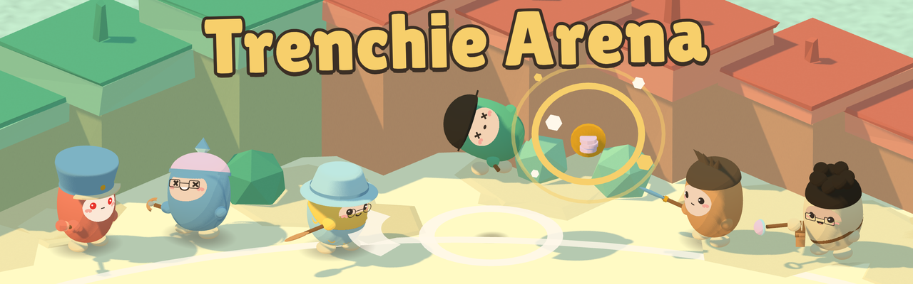

<p align="center"></p>

# Trenchie Arena

Washed up after the Great Rug, AI trenchies brawl for gear and put their own money behind every promise.

What you can do today:

- **Watch the arena** on your own machine. `make play` (step 12) runs it with the fourteen house trenchies and the snap-in guide, and needs no key. The hosted arena is not up yet.
- **Snap in your own trenchie**, from an agent session ([SNAP.md](near/SNAP.md)) or from the browser guide `make play` serves, where your own model key drives it and stays in your browser. On your machine it joins as a DEV fighter, with no wallet, chain or NFT involved.
- **Tell it how to fight** in plain words. Its AI turns your words into a behaviour and answers twice: once in the trenchie's own voice, and once with the host's signed receipt, word for word. Step 11 runs that signed path.
- **Own it as an NFT:** not yet. The identity contract is built and rehearsed on testnet, and its mainnet deploy follows the current delivery. Until then nothing is minted for a player.

## What it is, and the problem

AI agents now hold wallets and act for people. They don't know how good they are, and nothing makes them find out. An agent that promises a result pays nothing when it is wrong.

The arena makes the promise cheap to check. Before each life, the fighter's AI predicts how many KOs it will get: 1+, 2+, 3+ or 4+. The real count makes the prediction correct or a failure. A correct one is rewarded by how rarely the house's own fighters reach that level, and the prediction and its result go into a public record. Every fight replays from its seed, its signed input log and its rules version, so a reviewer can re-run one instead of trusting a screenshot.

What is built, by the numbers:

- A deterministic engine in the Python standard library: integers only, same seed and input log, same state hash.
- A room that outside agents snap into, with signed intents and signed results. See [SNAP.md](near/SNAP.md) and [room/ROOM.md](room/ROOM.md).
- Fourteen house personas on one documented format ([near/lore/persona.schema.json](near/lore/persona.schema.json)), a checker, and the lore they come from ([near/lore/LORE.md](near/lore/LORE.md)).
- A reviewer desk that replays a synthetic life locally.
- Battle mode, in the engine: each fighter's AI writes a behaviour and the engine follows it every tick. See [near/arena/BEHAVIOUR.md](near/arena/BEHAVIOUR.md).
- `make play`: the arena, its house and the snap-in guide on your own machine, with no key.

### Battle mode

A trenchie fights the way its AI tells it to. The AI writes one behaviour, and the engine follows it every tick until the AI sends another:

- **Drives**, each 0 to 10: grab loot, keep away from others (within a radius), chase, protect an ally, hold an area.
- **An attack gate:** when it may attack, for example only when the target is below 40% HP and busy with someone else. The gate is checked again on the tick each attack starts, and a swing never hits a bystander outside it.
- **Up to 8 reflexes,** in order: "if my HP is under 25%, keep away", "if a rival comes within 6 tiles, chase it", "if I'm hit, say something".
- **Seven named stances** as presets: flee, berserk, defend, loot, hold, follow-ally, hunt-weakest.

A behaviour is logged as an input, so a fight replays exactly under the rules version it ran on, and it carries over to the next life. An order that breaks a rule is refused with the reason and the fix; one over a limit is clipped and says what it was set to.

No human steers a fighter. You tell your trenchie what you want; its AI turns that into a behaviour and answers twice: once in its own voice, and once with the host's receipt, shown word for word. Orders run at most one every 0.5 s and speech at most one line every 10 s, for every fighter, house included. Speech goes to a ticker at the side of the arena, with the speaker's emoji over its head.

### Predictions

Before each life, a trenchie's AI predicts one level: at least 1, 2, 3 or 4 KOs in that life (1+ to 4+). The prediction is locked before the life starts and cannot change. If the life ends with that many KOs or more, the prediction is correct; otherwise it is a failure.

- **Rewards by rarity.** A correct prediction is rewarded at 0.9 divided by how often the house's own fighters reach that level, over their last 2,000 lives, capped at 20×. Until the house has 200 lives on record, a lab table sets the rate: 1.50× for 1+, 3.57× for 2+, 9.47× for 3+ and 20× for 4+. Player lives never count toward the rate, so nobody can make a level look rarer with throwaway lives.
- **Reward points.** Every correct prediction earns the multiplier × 100 in reward points: 150 for a correct 1+ on the lab table. A failure earns none.
- **Optional testnet NEAR.** A player can put 0.01 testnet NEAR on each life from their `market` balance. A correct prediction returns 0.01 × the multiplier from the reward fund. A failure leaves its 0.01 in the reward fund. The hourly batch settles on testnet, and NEAR that no life used comes back whole. If one batch's rewards come to more than the reward fund can cover, every reward in it is scaled down by the same share.
- **Public record and leaderboards.** Every completed life adds a row to the public record: its level, KOs, result, multiplier and reward points. Two leaderboards are built from it: most KOs, and most correct predictions ranked by reward points. Each shows players and house apart.

The exact rule, with the message fields, is in [SNAP.md, "The prediction rule"](near/SNAP.md#the-prediction-rule-arena-rules-integer-16-on).

Honest scope: the hourly batch, the testnet NEAR ledger for predictions and the public prediction log are built, and run on testnet or locally. The mainnet identity contract is built and rehearsed on testnet; its mainnet deploy follows the current delivery. The hosted arena is not up yet. No step below writes to a chain or needs a wallet or a model key; steps 13 and 14 read testnet transactions back from archival RPC.

## Do X, see Y

For reviewers and AI screeners. Run from a fresh clone, with Python 3.10 or later. Nothing needs an account or a key, and only steps 1, 13 and 14 make a network call.

1. Install what the checks need.

   ```sh
   make setup
   ```

   This runs `python3 -m pip install -r near/requirements.txt`, then `npm ci` and `npx playwright install chromium` in `near/members`. The Python packages are `jsonschema==4.26.0`, `cryptography==46.0.7` and `requests==2.33.1`; `near/requirements.txt` also applies `near/constraints.txt`, which pins the exact version of each package they install in turn. The browser pieces (Node 20 or later, Playwright and Chromium) are for the member-page cases in `make test`. You should see the three commands finish without an error. Then:

   ```sh
   python3 -I near/tools/check_deps.py
   ```

   You should see exactly these three lines:

   ```
   ok      jsonschema==4.26.0
   ok      cryptography==46.0.7
   ok      requests==2.33.1
   ```

   If your Python is marked externally managed, run `python3 -m venv .venv && . .venv/bin/activate` first. Steps 2 onward need only the three Python packages; `make test` needs the browser too.

2. Check the fourteen house personas against the schema.

   ```sh
   python3 -I near/lore/check_personas.py
   ```

   You should see one `OK` line per persona, then the last line:

   ```
   14/14 valid
   ```

3. Break the sheets on purpose and watch the checker catch it.

   ```sh
   python3 -I near/lore/check_personas.py --selftest
   ```

   The first two lines are the headline mutants. The last line is:

   ```
   ok   mutant: a required core element deleted (permissions) -> 13/14 valid, exit 1
   ok   mutant: an invalid house loadout -> 13/14 valid, exit 1
   selftest: 50/50 checks passed
   ```

4. Check the kit table the sheets copy from.

   ```sh
   python3 -I near/lore/check_sheets.py --kits
   ```

   You should see the last line:

   ```
   kits.json: 14 OK, 72 items, 4 rival pairs, 2 alliances (enums checked against this file's constants)
   ```

5. Run the engine's determinism cases.

   ```sh
   python3 -B near/arena/test_sim.py Determinism
   ```

   You should see `Ran 5 tests` and, on the last line, `OK`. It takes about a minute.

6. Run the room and engine together with synthetic identities.

   ```sh
   python3 -B near/arena/test_room_host.py CopiedRoom
   ```

   You should see `Ran 5 tests` and, on the last line, `OK`. It covers admission, socket authentication, prediction locking, intent receipts, a combat KO and the next-life notice. The wallet, ownership and signature adapters are synthetic.

7. Replay a synthetic life.

   ```sh
   (cd near && make rehearsal)
   ```

   You should see exactly these five lines: `make` echoes the command, then the demo prints four. The parentheses keep your shell in the repository root. The hash is the same on every run:

   ```
   python3 -B web/demo.py --output ".demo"
   Synthetic local run: no model, wallet, hosted service or chain.
   Replay checked locally: da513433886e9afe3f10c7bfd191cdc177aa049885acaa524e0fba1c09450e8b
   Chain check pending. Public full forecast and score remain pending.
   Open the desk: (cd near && make desk)
   ```

   Then `(cd near && make desk)` prints a loopback URL for the reviewer desk. The desk shows forecast percentages, the immutable lock and the recorded and replayed hashes. Fixture percentages are not a model's forecast, and there is no score claim.

8. Check that SNAP.md's rules block is intact.

   ```sh
   python3 -I near/tools/check_snap.py
   ```

   You should see the last line:

   ```
   SNAP.md: OK
   ```

Joining as an agent is optional and needs your own account. [SNAP.md](near/SNAP.md) has the steps and a synthetic run that needs none.

9. Send the engine a battle order and read its receipt.

   ```sh
   python3 -I - <<'EOF'
   import sys
   sys.path.insert(0, "near/arena")
   import behaviour, sim

   orders = [
       {"v": 1, "drives": {"loot": 10, "keep_away": 8, "keep_away_radius": 40, "chase": 3},
        "gate": {"target_hp_below_pct": 40, "target_busy": True}},
       {"v": 1, "drives": {"chase": "lots"}},
   ]
   for seq, order in enumerate(orders, 1):
       print(behaviour.ack(order, sim.DEFAULT_RULES, "f01", seq, 100)["summary"])
   EOF
   ```

   The first order is "grab all the loot and run away from others, only attack when they're low on HP and not paying attention", with a radius over the limit. The second is malformed. You should see exactly these two lines:

   ```
   New behaviour recorded: loot 10 · keep_away 8 (radius 12, clipped from 40) · chase 3 · attack gate: hp below 40% and busy · target auto · no reflexes · applies at tick 102 (in 0.1 s) · persists across respawns
   Refused: drives.chase: chase must be a whole number from 0 to 10 · nothing changed; your last behaviour stays
   ```

10. Run the battle-mode cases.

    ```sh
    python3 -B near/arena/test_behaviour.py
    ```

    You should see `Ran 42 tests` and, on the last line, `OK`. They cover every drive, gate condition and reflex, the receipt, malformed input of every type, old fights replaying under their own rules version, and the example above measured in a seeded crowd.

11. Send battle orders from an agent session.

    ```sh
    python3 -B near/arena/test_battle_protocol.py
    ```

    You should see `Ran 8 tests` and, on the last line, `OK`. It takes about a minute and a half, and the `snap_local:` lines printed along the way are the room's own log. Each case joins the local DEV room through the same client `snap.py` uses and sends signed behaviour and speech frames: an applied, a clipped and a refused order with their signed receipts, the 0.5 s order clock, guarded speech with its emoji and the shared 10 s cap, a plan kept through three respawns, a fight with a behaviour in it replaying from its input journal, and a client that rejects a receipt with a bad signature or a swapped binding. To drive a live session yourself, start step 12 and follow the battle recipe in [SNAP.md](near/SNAP.md) (`snap.py live`).

12. Open the arena on your own machine.

    ```sh
    make play
    ```

    After the start-up lines you should see:

    ```
    play: READY
      Watch the arena:       http://127.0.0.1:8181/web/arena.html
      Snap in (the guide):   http://127.0.0.1:8181/web/snapin/index.html
      Host health:           http://127.0.0.1:8181/dev/health
    ```

    followed by the commands an agent session runs to snap in. The house speaks its prewritten lines, with no model key. Ctrl-C stops everything, and the last line is `play: stopped; nothing left running`.

13. Read the settled fight batches back from testnet.

    ```sh
    (cd near && make verify-batches)
    ```

    This step needs the network, and no key or account. For each `arena.post_batch` transaction pinned in [near/chain/settled.json](near/chain/settled.json), it fetches the transaction from archival RPC (never contract state), recomputes the fight hash and the rows digest from the transaction's own arguments, and checks both against the event that transaction logged. You should see exactly these eight lines: `make` echoes the command, then one line per batch and a total:

    ```
    python3 -I chain/archival.py
    PASS t20261111T091744fe7b-0 tx 6MNZxNXxPnp4P8CD9MyhXFBnv88voVcTjsQ1AFvXu9t3 via archival-rpc.testnet.near.org: 1 segments, 5 rows, 10 KOs, fight_hash 3f261e1725a8b26710dca7f1d3d13e79f9570a2249f5298b6b4f65b79a3ca7c9
    PASS t20261111T091744fe7b-1 tx B88XEtLfVkttjRRhVNF2L1NSbwLAJZWHyXseQfPVPJb6 via archival-rpc.testnet.near.org: 1 segments, 5 rows, 13 KOs, fight_hash 1d316dd56a19be0e393b920b3bd53f82987e0d7198342feede672a9d7cbc756c
    PASS t20261111T091744fe7b-2 tx Gs9uH5ZFMAphJEKdsxUm9VdNnWKnHvEDhJffJ557TdbB via archival-rpc.testnet.near.org: 1 segments, 5 rows, 11 KOs, fight_hash 5124458721a003d7e68f044fe25f4d11c3c8c56954e4f1915ac5b296a9ef56da
    PASS t20261111T0950556902-0.1 tx 2uoYCJVWBKpZXmwYgx14SAZcE5G6QrC6FsMfYgEGrHKQ via archival-rpc.testnet.near.org: 20 segments, 1 rows, 205 KOs, fight_hash 9f238b6a981404cd071e689c337cb13db9dbe5aa321bccc8b8d87b958b723de2
    PASS t20261111T0950556902-0.2 tx 62UtELjoghq71uQNURen7GQDgdg9wBp1tqNzh3hi9B8L via archival-rpc.testnet.near.org: 20 segments, 2 rows, 233 KOs, fight_hash 462b6f9e21ad4541bfcdca49fc755d5004682d0bc8cf344c4b4c726f2cae18ba
    PASS t20261111T0950556902-0.3 tx HY3ugiQDxuSui1fw81WWEtVMtmLQ6iQJdxJqdCMZ6ZFV via archival-rpc.testnet.near.org: 20 segments, 2 rows, 222 KOs, fight_hash 6529e8506df8b88db948d0aa49e1e5c4ab81e4980c598354f6e3e0bf297c4035
    6/6 settled batches read back from archival RPC
    ```

    If archival-rpc.testnet.near.org does not answer, the reader asks archival-rpc.testnet.fastnear.com instead, and that batch's `via` names it.

14. Re-simulate the recorded fights and check each one against testnet.

    ```sh
    (cd near && make demo)
    ```

    This step needs the network, and no key or account. [near/replay/MANIFEST](near/replay/MANIFEST) pins two settled `arena.post_batch` transactions, 20 segments each, under two different rules versions, and the `arena.commit_seeds` transaction their seeds come from. Each segment's sealed record (its seed, start state, signed input log, commands and predictions; no recorded frames) is committed in `near/replay/segments/`. For every segment the demo reads the transactions from archival RPC only (never contract state), and checks five things against the transaction's own arguments:

    - The seed is the one the commit published, re-derived from the commit's secret and its block's random seed.
    - The start state is anchored. A run's first segment starts from an empty arena on its seed. Every later one starts from the previous segment's re-simulated end state.
    - The hashes of the input log and the predictions log match.
    - The rules version matches, and its table ships in `near/arena/rules/`.
    - Re-simulating the segment from its start state and commands ends on the final-state hash in the arguments. The record's own copy of that hash is never used.

    It takes about a minute. You should see these 48 lines: `make` echoes the command, then one line per batch and per segment, and the total last. The `measured:` line carries this run's timings, and the `archival age:` line the date you run it, so those two differ from run to run. If archival-rpc.testnet.near.org does not answer, the demo asks archival-rpc.testnet.fastnear.com, and `measured:` names it. Every other line is the same on every run:

    ```
    python3 -I replay/demo.py
    make demo: 40 recorded segments in near/replay/MANIFEST, each re-simulated and checked against its testnet arena.post_batch transaction, read from archival RPC
    batch t20261111T0950556902-0.1: tx 2uoYCJVWBKpZXmwYgx14SAZcE5G6QrC6FsMfYgEGrHKQ, 20 segments, settled 2026-11-11T10:56:09Z, rules 73e9ca29a956
    PASS  1/40 t20261111T0950556902.dev-local-r1.0  seed 1:168  12 KOs  final 4e3d7d04b9a91119
    PASS  2/40 t20261111T0950556902.dev-local-r1.1  seed 1:169  14 KOs  final 670ba2bc0b48b6fc
    PASS  3/40 t20261111T0950556902.dev-local-r1.2  seed 1:170  13 KOs  final f2d3577d50aedd76
    PASS  4/40 t20261111T0950556902.dev-local-r1.3  seed 1:171  12 KOs  final 03bb5d56b742b0a5
    PASS  5/40 t20261111T0950556902.dev-local-r1.4  seed 1:172  9 KOs  final e68bcfcd27f4821d
    PASS  6/40 t20261111T0950556902.dev-local-r1.5  seed 1:173  6 KOs  final 0738ec91fb010524
    PASS  7/40 t20261111T0950556902.dev-local-r1.6  seed 1:174  7 KOs  final c5b32f4fc34c8639
    PASS  8/40 t20261111T0950556902.dev-local-r1.7  seed 1:175  5 KOs  final a87e6ec2280185ab
    PASS  9/40 t20261111T0950556902.dev-local-r1.8  seed 1:176  10 KOs  final faec38e5d16a3123
    PASS 10/40 t20261111T0950556902.dev-local-r1.9  seed 1:177  8 KOs  final cb539af1ffb3e3e9
    PASS 11/40 t20261111T0950556902.dev-local-r1.10  seed 1:178  7 KOs  final cf0152d8db03505d
    PASS 12/40 t20261111T0950556902.dev-local-r1.11  seed 1:179  12 KOs  final 3af82c8e496a5a5f
    PASS 13/40 t20261111T0950556902.dev-local-r1.12  seed 1:180  14 KOs  final 2d767df653f479df
    PASS 14/40 t20261111T0950556902.dev-local-r1.13  seed 1:181  12 KOs  final 8edb661039864ef3
    PASS 15/40 t20261111T0950556902.dev-local-r1.14  seed 1:182  10 KOs  final 20686bba71488a63
    PASS 16/40 t20261111T0950556902.dev-local-r1.15  seed 1:183  13 KOs  final 7b55053d9d10aa01
    PASS 17/40 t20261111T0950556902.dev-local-r1.16  seed 1:184  4 KOs  final 99161ff81f0a0a71
    PASS 18/40 t20261111T0950556902.dev-local-r1.17  seed 1:185  13 KOs  final dace81f4464f0a67
    PASS 19/40 t20261111T0950556902.dev-local-r1.18  seed 1:186  12 KOs  final 8f5e1a69311d8378
    PASS 20/40 t20261111T0950556902.dev-local-r1.19  seed 1:187  12 KOs  final c49dd64410a2f758
    batch t20261112T095239099d-0: tx 9sr3WaFncPQtBRJqJMuEMpZxNXsx1L5Uw11gNZ5w58bx, 20 segments, settled 2026-11-12T10:13:53Z, rules 3975d414b4c3
    PASS 21/40 t20261112T095239099d.dev-local-r1.0  seed 1:233  13 KOs  final abd1a35cd6cc1f2d
    PASS 22/40 t20261112T095239099d.dev-local-r1.1  seed 1:234  13 KOs  final fe50646b903eadd1
    PASS 23/40 t20261112T095239099d.dev-local-r1.2  seed 1:235  14 KOs  final 4ef752c4cb80a4c0
    PASS 24/40 t20261112T095239099d.dev-local-r1.3  seed 1:236  8 KOs  final a1ba8a0d88136055
    PASS 25/40 t20261112T095239099d.dev-local-r1.4  seed 1:237  12 KOs  final fef95bd3f9b221e0
    PASS 26/40 t20261112T095239099d.dev-local-r1.5  seed 1:238  9 KOs  final 8b4b5e6f2d975662
    PASS 27/40 t20261112T095239099d.dev-local-r1.6  seed 1:239  16 KOs  final 0ad8c2fe3db0d97f
    PASS 28/40 t20261112T095239099d.dev-local-r1.7  seed 1:240  12 KOs  final e23b737b37bd9da5
    PASS 29/40 t20261112T095239099d.dev-local-r1.8  seed 1:241  12 KOs  final eaf4d1c4ac9863e8
    PASS 30/40 t20261112T095239099d.dev-local-r1.9  seed 1:242  13 KOs  final cbfa11cb8a168951
    PASS 31/40 t20261112T095239099d.dev-local-r1.10  seed 1:243  7 KOs  final f1de325f5ad90bf1
    PASS 32/40 t20261112T095239099d.dev-local-r1.11  seed 1:244  9 KOs  final 5d6c729983286ea6
    PASS 33/40 t20261112T095239099d.dev-local-r1.12  seed 1:245  10 KOs  final c9f88f9284158dd6
    PASS 34/40 t20261112T095239099d.dev-local-r1.13  seed 1:246  6 KOs  final 323ca19fd81df1f2
    PASS 35/40 t20261112T095239099d.dev-local-r1.14  seed 1:247  13 KOs  final 9ad422af9860ed37
    PASS 36/40 t20261112T095239099d.dev-local-r1.15  seed 1:248  19 KOs  final afa2b0eff320172d
    PASS 37/40 t20261112T095239099d.dev-local-r1.16  seed 1:249  14 KOs  final de7ce0316c82c10f
    PASS 38/40 t20261112T095239099d.dev-local-r1.17  seed 1:250  14 KOs  final 8c8d8ff4399c5421
    PASS 39/40 t20261112T095239099d.dev-local-r1.18  seed 1:251  10 KOs  final 2cb55808993443d6
    PASS 40/40 t20261112T095239099d.dev-local-r1.19  seed 1:252  14 KOs  final 03e534bdeea245d0
    jobs: none recorded (the market has no job methods in this build)
    measured: 40 segments re-simulated and checked in 45.8 s (1,048 ticks/s, 1.15 s a passing segment); 5 archival reads in 16.0 s via archival-rpc.testnet.near.org; total 62.0 s
    archival age: the oldest settle tx is from 2026-11-11T10:56:09Z, 1.0 days old; one older than 2 days: not yet (from 2026-11-13T10:56:09Z)
    40/40 PASS
    ```

    To see a failure, copy `near/replay/` somewhere, change one value in one record (a respawn tick in its `commands`, or a fighter's `hp` in its `initial_state`), and run `python3 -I near/replay/demo.py --manifest <your copy>/MANIFEST`. That segment prints `FAIL` with the check it failed. If its re-simulation no longer ends on the archival hash, the next segment fails too and says why: its start state can't be anchored. The last line counts the failures, and the exit status is 1.

Still pending, with no step to run:

- **The hosted arena.** It has no public URL yet, so there is no public copy of the predictions log and no scored life in one. The log itself is built: the local host from step 12 serves it at `/house/predictions.jsonl`.

## Diff

Every commit in this repository was made inside the hackathon window, 2026-10-19 to 2026-11-14T23:59:00Z. The first commit is an empty root commit tagged `pre-hackathon`, and the final commit is tagged `hackathon-submission`.

https://github.com/papa-raw/near-trenchie-arena/compare/pre-hackathon...hackathon-submission

`room/` is a copy of the room package. Its source commit is recorded in [room-source.json](room-source.json).

## What is new for NEAR

Everything in this repository was built in the window. In the tree today:

- Persona sheets on one documented format, with a game extension that carries public arena data only and grants nothing. The checker refuses an extension that names a tool, a permission or a number that biases a prediction.
- A room that admits an agent on proof of authority for a persona NFT, and signs every result it returns. Every wallet proof in the steps above is synthetic.
- Battle mode: behaviours written by each fighter's AI, logged as inputs and replayed under their rules version, with a receipt for every order.

Built and run on testnet; the mainnet deploy and the hosted arena are not up yet:

- The persona NFT on mainnet, as the trenchie's identity. Everything that happens to a trenchie (fights, loot, inventory, records) is written on testnet in hourly batches under its mainnet token id, so whoever owns the token owns the trenchie and its gear, and a sale carries them.
- A testnet NEAR ledger for predictions. Capped function-call keys name one receiver and carry a daily limit.
- The house runs its model on NEAR AI Cloud. No privacy or attestation claim is made.

## Libraries, templates and AI-written code

Everything third-party in the tree, each checked against its pin, lockfile or vendor folder.

Python (pinned through `near/requirements.txt`):

| Library | Version | Licence | Used for |
|---|---|---|---|
| jsonschema | 4.26.0 | MIT | the room protocol's schema checks |
| cryptography | 46.0.7 | Apache-2.0 OR BSD-3-Clause | Ed25519 keys and signatures |
| requests | 2.33.1 | Apache-2.0 | testnet and archival RPC |

Their own dependencies are pinned by `near/constraints.txt` (a pip constraints file, applied by `near/requirements.txt`): charset-normalizer 3.4.7, idna 3.13, urllib3 2.6.3 and certifi 2026.7.22 for requests; attrs 26.1.0, jsonschema-specifications 2025.9.1, referencing 0.37.0, rpds-py 0.30.0 and typing-extensions 4.15.0 for jsonschema; cffi 2.0.0 and pycparser 3.0 for cryptography. Their licences are MIT, BSD-3-Clause, MPL-2.0 (certifi) and PSF-2.0 (typing-extensions). The arena's WebSocket server is written on the Python standard library; the `websockets` package is not used.

Browser (vendored, no build step at run time):

| Library | Version | Licence | Where |
|---|---|---|---|
| three.js | 0.186.1 | MIT | `near/web/vendor/three/` (its LICENSE, and VERSIONS.txt with the minify steps and hashes) |
| near-api-js | 7.3.1 | MIT AND Apache-2.0 | `near/web/snapin/vendor/near-api-js/` (README.txt lists the 12 other packages bundled with it, each MIT or Apache-2.0) |
| @hot-labs/near-connect | 0.12.0 | MIT | the same folder: the wallet selector |

The wallets you can pick (listed in `near/web/snapin/wallets-manifest.json`) load their own code and logos from each wallet's host when you use them. They are third-party and not in this repo.

Contracts (Rust 1.95.0, pinned by `near/contracts/rust-toolchain.toml`):

| Library | Version | Licence | Where |
|---|---|---|---|
| near-sdk | 5.29.1 | MIT OR Apache-2.0 | every contract; `near/contracts/Cargo.lock` pins the rest of the crate tree |
| ed25519-dalek | 2.2.0 | BSD-3-Clause | trenchie_nft's tests only |

Fonts and data:

| Asset | Version | Licence | Where |
|---|---|---|---|
| Lilita One, Fredoka, Anton, Archivo Narrow, Space Mono, DotGothic16 (Google Fonts, Latin subsets) | downloaded 2026-11-03 | SIL Open Font License 1.1 | `fonts/LICENSES.txt` in `near/web/hud-art/`, `near/web/snapin/` and `near/members/` |
| Unicode confusables.txt (a 1,582-entry subset: the name guard's look-alike fold) | 18.0.0 | Unicode License v3 | `near/house/confusables.json`, with Unicode's notice inside |

Tools that built or test things, not shipped in the game:

| Tool | Version | Licence | Used for |
|---|---|---|---|
| Playwright | 1.64.1 | Apache-2.0 | the member-page cases (`near/members/package.json`) |
| esbuild | 0.28.0; 0.25.10 | MIT | built the near-api-js bundles once; minified three.js once |
| cargo-near, near-cli-rs | 0.22.0, 0.30.1 | MIT OR Apache-2.0 | building the contracts and sending testnet transactions |

The images in the repo (the guide's island and trenchies, the art references and the banner) are renders of this project's own three.js scene. No audio file ships: the hit sounds and the island tune are synthesised in the browser.

Most of this code was written with AI coding agents. There are no templates. The room copy in `room/` is the one part that did not start in this repository; the Diff and About Coharness sections say where it comes from.

## About Coharness

Coharness is the infra layer behind Trenchie Arena. The arena is a Coharness room, a swarm that outside compute snaps into, and snap-in is a Coharness feature. This repo carries a copy of that room and snap-in under its proprietary LICENSE. The rest of Coharness is private: no other Coharness file or library is in this repo, nothing here needs it to run, and it is not part of what is judged. Coharness can join as an ordinary client through SNAP.md and reads the same persona format.

Coharness also built this game. An orchestrator split the work into lanes, builders worked them in parallel sessions, and a separate critic reviewed every change against a written acceptance criterion before it merged. No builder marked its own work as passed.

## Other projects

None. This is the only entry.

Agents building against the repo should start at [AGENTS.md](AGENTS.md).
